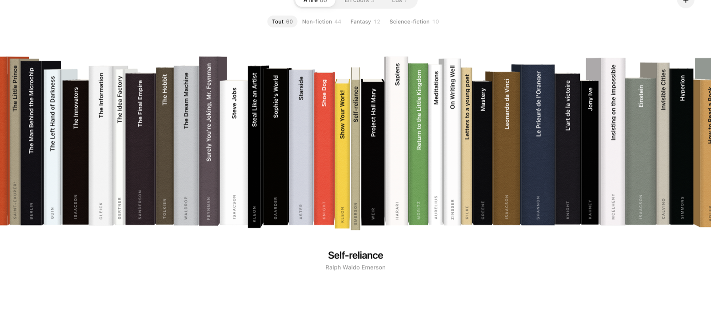

# Booksidian

Every book you want to read, at a glance.



Booksidian turns the books in your Obsidian vault into a 3D shelf you can browse. Every book stays an ordinary note: the shelf only reads and writes its properties.

- **Browse**: books stand on their spines. Scroll with the mouse wheel, the trackpad or the arrow keys, or drag the shelf.
- **Open a book**: click once to pull it out and see its cover. Click again to open it, and its page shows why you want to read it, its summary, themes, tropes, related books, and the notes you wrote about it.
- **Three shelves**: To read, Reading, Read, with a genre filter (All, Non-fiction, Fantasy, Science fiction).
- **Add a book**: the + button searches [Open Library](https://openlibrary.org) and creates the note, with cover, author, year, summary and genres.
- **Remove a book**: "Remove from the shelf" on its page takes it off the shelf. The note and what you wrote in it stay in your vault.

The interface is in English or French. It follows Obsidian's language, or the one you pick in the settings.

## Books are notes

There is no separate database. A book is a note whose properties say `type: book` and carry a reading status. Everything you do on the shelf (mark as read, add or remove a book) is written to that note. Removing a book only clears its reading status.

```markdown
---
type: book
status: "to read"         # to read | reading | read
author: "James Islington"
year: "2023"
cover: "https://covers.openlibrary.org/b/id/15247547-L.jpg"
genres:
  - "fiction"
  - "fantasy"
---
## Why read it
One sentence on what made you want to.

## Summary
What the book is about.
```

Notes that link to a book, and notes in a folder named after it, show up on its page. Other book notes, and lists that link to more than two books (a reading list, an index), are left out.

## Settings

- **Language**: the language of the shelf. Default: the same as Obsidian.
- **Folder for new books**: where a book you add is created. Empty: `Books/`.
- **Book note type**: the word after `type:` that makes a note a book. Empty: `book` or `livre`.

## Network use

Booksidian connects to Open Library (openlibrary.org and covers.openlibrary.org) to search for books, fetch their details when you add one, and download their covers. Covers are cached in the plugin's folder, so the shelf works offline once they are loaded. No account, no tracking, nothing sent anywhere else.

## Installation

In Obsidian: **Settings → Community plugins → Browse**, then search for *Booksidian*.

Manually: download `main.js`, `manifest.json` and `styles.css` from the [latest release](../../releases/latest) into `<your vault>/.obsidian/plugins/booksidian/`, then enable the plugin.

Desktop only for now.

## Build

```bash
npm install
npm run build
```

## License

[MIT](LICENSE)
